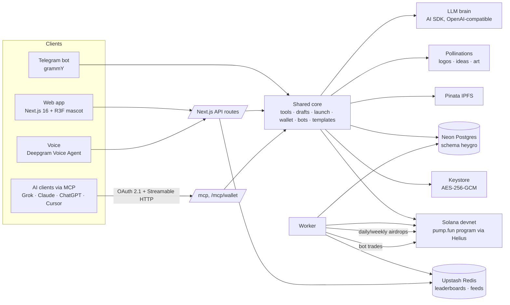

<div align="center">


# HeyClawLaunch

**Say “Hey Claw, launch a coin.”** A chat, voice, Telegram and MCP launchpad for pump.fun coins on Solana, with a 3D claw-robot mascot, AI-generated coins, live charts, volume bots and a volume leaderboard with daily airdrops.

Devnet build · Next.js 16 · React 19 · Neon · Upstash · pump.fun SDK · MCP (OAuth 2.1)

</div>


| Launch (chat with Claw) | Token page (live chart) |
|---|---|
|  |  |
| **Explore** | **Mascot** |
|  |  |

## Features

- **Launch by talking.** Claw (the LLM brain + tools) asks for name, ticker, logo, fee recipient and pair, shows a summary, and launches only after an explicit yes. No wallet, no SOL, no dev buy: the platform pays.
- **Two-transaction launch, HeyGrok-style fees.** Tx 1 creates the coin on pump.fun (`createV2`), tx 2 locks fee sharing on chain: **80% to the creator / fee recipient, 20% to the platform**. Holders mode routes fees to holders instead.
- **Per-user custodial wallets.** Every user (web/SIWS, X, Telegram) gets a server-created wallet, encrypted with AES-256-GCM (per-wallet DEK wrapped by a master key). `claim_fees`, `withdraw` (any address, preview → confirm) and `swap` (devnet: bonding curve) act on it. Users can **export their private key** anytime (web: re-sign with wallet; Telegram: `/exportkey` in DM, with a warning and confirm).
- **AI coins.** `generate_logo`, `generate_token_idea`, “Generate everything” and **Templates**: ready-made coins (AI name, ticker, description, logo) launched in one tap with a confirm step.
- **Real-time charts.** A worker indexes every bonding-curve trade of platform coins from Helius devnet RPC into Neon; the token page and bots tab render OHLC candles (15s–1h), volume and a live trade feed.
- **Volume bots (devnet SOL).** Volume, bump, buy, sell (TWAP your bag) and holder-booster bots, packages from **0.2 / 1 / 2 / 3 / 5 SOL**, paid from the user's wallet, executed as real buys/sells on the pump.fun curve by encrypted bot wallets funded from the launch wallet (with a reserve). Filters: new / about to graduate / graduated.
- **Leaderboard + airdrops.** Upstash sorted sets rank creators by their coins' trading volume (daily / weekly / all-time). The worker pays the **daily top 3** (0.01 / 0.006 / 0.004 SOL) and the **weekly #1** (0.02 SOL) on devnet, idempotently, with history and countdowns.
- **Telegram bot** with the full command set (launch, quick, templates, wallet, deposit, claim, withdraw, exportkey, mylaunches, token, leaderboard, airdrops, bots, settings, help…).
- **Voice.** Deepgram Voice Agent with functions mapped to the launch/wallet tools; the mascot talks while it answers.
- **3D claw-robot mascot** (three.js / R3F): hover + breathing, cursor-tracking eyes, blinking, thinking, talking and a launch celebration.
- **MCP server** (Streamable HTTP, protocol 2025-06-18) with OAuth 2.1 (DCR, PKCE, resource indicators, protected-resource metadata) so Grok, Claude, ChatGPT or Cursor can launch and manage coins.

## Architecture



## MCP

| Endpoint | Purpose |
|---|---|
| `POST {APP_URL}/mcp` | Launch tools (no sign-in needed to draft; launching is tied to the caller) |
| `POST {APP_URL}/mcp/wallet` | Wallet tools (OAuth: Authorize once with your Solana wallet or X) |
| `GET /.well-known/oauth-protected-resource/mcp` | RFC 9728 metadata |
| `GET /.well-known/oauth-authorization-server` | RFC 8414 metadata (DCR at `/oauth/register`) |

Tools: `prepare_launch`, `list_pairs`, `get_logo_upload_link`, `confirm_launch`, `launch_status`, `my_launches`, `my_wallet`, `claim_fees`, `withdraw`, `swap`, plus `generate_logo`, `generate_token_idea`, `list_templates`, `use_template`, `leaderboard`, `volume_bot`. Sensitive tools (`confirm_launch`, `withdraw`, `swap`, `volume_bot`) need an explicit confirmation step.

## Setup

```bash
pnpm install
cp .env.example .env.local      # fill in the values (never commit .env.local)
pnpm migrate                    # creates/updates tables in the `heygro` schema only
pnpm dev                        # web + API + MCP on :3100
pnpm bot                        # Telegram bot (long polling)
pnpm worker                     # fee split retries, trade indexer, bots, airdrops
pnpm seed-templates 10          # AI-generate launch templates
pnpm gen-art                    # regenerate site art (Grok Imagine, falls back to flux)
```

Devnet tests live in `scripts/devnet/` (multi-user launch → claim → withdraw, MCP OAuth E2E, image generation, volume bots).

## Environment

| Variable | What it's for |
|---|---|
| `DATABASE_URL` | Neon Postgres (serverless driver, all tables in schema `heygro`) |
| `SOLANA_CLUSTER` | `devnet` |
| `SOLANA_RPC_URL` | Helius devnet RPC (indexer + trades) |
| `LAUNCH_WALLET_SECRET` | Platform launch wallet (pays launches, receives 20% share, funds bots/airdrops) |
| `LAUNCH_MIN_LAMPORTS` | Pause launches below this balance |
| `PLATFORM_SHARE_BPS` | Platform fee share, `2000` = 20% |
| `LAUNCH_LIMIT_PER_DAY` | Per user / IP / fee wallet daily limit |
| `LAUNCHES_ENABLED` | Kill switch |
| `KEYSTORE_MASTER_KEY` | AES-256-GCM master key wrapping per-wallet DEKs (hex, 32 bytes) |
| `SESSION_SECRET` | Web sessions |
| `OAUTH_SIGNING_SECRET` | OAuth 2.1 server for MCP |
| `APP_URL` | Public base URL (OAuth issuer, MCP resource, links) |
| `SIWS_DOMAIN` | Sign-In-With-Solana domain |
| `MCP_ALLOWED_ORIGINS` | Extra allowed Origins for /mcp |
| `PINATA_JWT / PINATA_GATEWAY` | IPFS pinning of logos + metadata |
| `DEFAULT_MODEL / RIVER_BASE_URL / RIVER_API_KEY` | LLM brain (OpenAI-compatible) |
| `POLLINATIONS_API_KEY` | AI logos, token ideas, site art |
| `IMAGE_MODEL / ART_MODEL` | Image models (default flux.2-klein-4b / x-ai/grok-imagine-image) |
| `UPSTASH_REDIS_REST_URL / UPSTASH_REDIS_REST_TOKEN` | Leaderboard sorted sets + live feeds |
| `DEEPGRAM_API_KEY` | Voice agent |
| `TELEGRAM_BOT_TOKEN / TELEGRAM_BOT_USERNAME` | Telegram bot |
| `JUP_API_KEY` | Jupiter swaps (mainnet only) |
| `BOT_RESERVE_SOL` | Launch-wallet reserve the volume bots never touch (default 1) |

## Safety

- Devnet only by default; mainnet needs an explicit `SOLANA_CLUSTER=mainnet-beta`.
- Private keys are only decrypted inside the signer path and are never logged. Key export requires re-authentication and a confirm step.
- Every money-moving action (launch, withdraw, swap, bot order) has a preview → confirm gate.
- Independent project, not affiliated with xAI or pump.fun. Not financial advice.
